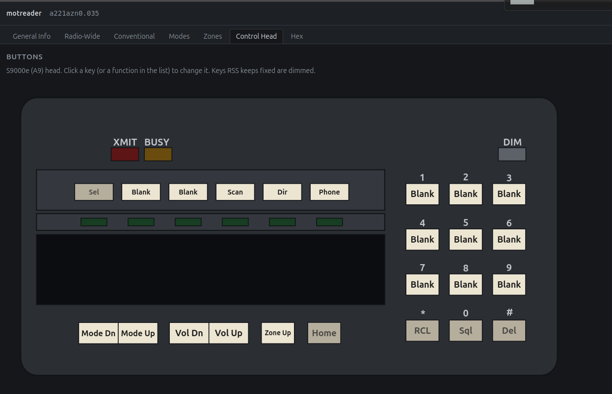
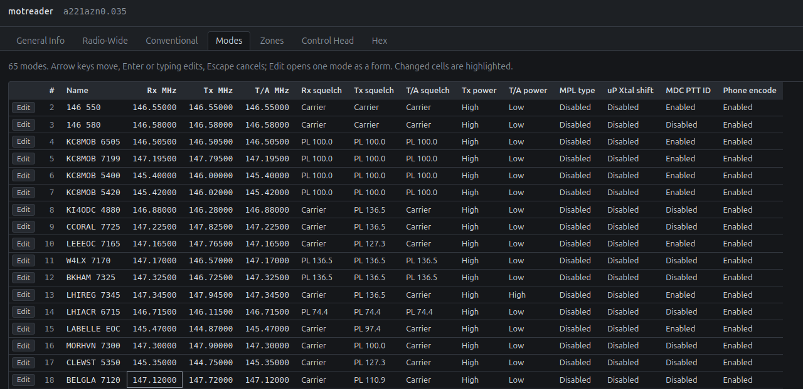
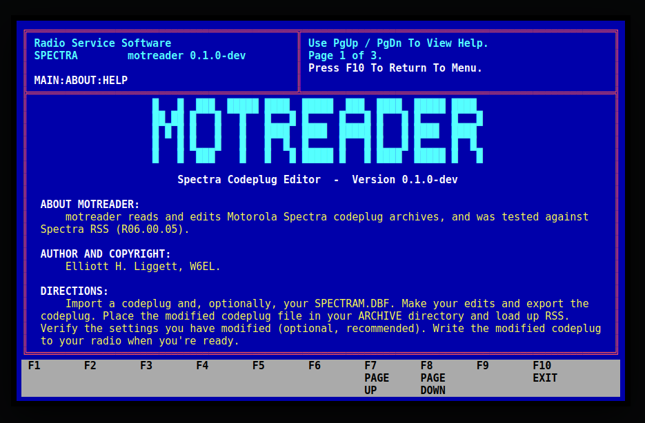

# motreader

Are you tired of tapping away in ancient dos software to program your radio's channels? Me too. 

motreader can read and write codeplug files for the Motorola Spectra series radios. You can also import and export CSV-formatted files for easier editing. 

## Author: 
Elliott Liggett, W6EL. Major portions of the code written by Claude Opus 4.8 and Opus 5.5. 

## Screenshots:

## Getting started:

You will still need to use old RSS to read and write to the radio itself. Thus, you're gonna need a way to move the codeplug files back and forth to your old dos machine. I recommend using a null modem cable and doing a serial port transfer. There is a way to do this within dos -- it's tricky to setup the first time, but once you get it going, you can then install programs designed for file management and serial i/o into dos. 

First load up the website: https://motreader.github.io/ 

Press "Import Codeplug". Now navigate to your codeplug file and the SPECTRAM.DBF file. The DBF is optional, it just clarifies for us the "Customer" and "Date programmed" fields. Use the control key to select both files at once, or just import each one separately. 

Make edits to the codeplug. There are little tabs at the top of the web app that are similar to the tabs in the old dos software. 

When you're done, press "Export Codeplug". Important: You must not rename the codeplug file. RSS requires the filename to match what is in the database (SPECTRAM.DBF). Thus, use directories (folders) to manage various versions of the codeplug, and keep the filename exactly the same. Don't forget to always make backups. 

Now transfer the file to your ancient dos machine. Open RSS and load the codeplug from disk. Browse around in RSS and make sure things look ok. 

Once satisfied, at your own risk, write the codeplug to the radio. 

## WARRANTY: 
No warranty is expressed or implied. This software may brick your radio, and by using it, you understand that you take that risk. Do not use this software on radios responsible for life support, law enforcement, fire, rescue, or related occupations.

## More screenshots, just for fun

